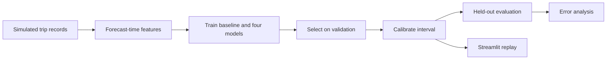

# Boarding Confidence

**Forecast how crowded a bus will get, 30 minutes before it leaves.**

Boarding Confidence is a decision-support project for bus operators. It estimates the **maximum number of passengers aboard at the same time** on a scheduled departure and compares that estimate with the vehicle’s seats and total capacity. An operator can use the forecast to decide which departures to review for capacity or scheduling changes.

**35,130 simulated departures** · **4 learned models + historical baseline** · **5.31 passengers test MAE**

## Try the Streamlit demo

From the repository root, run these commands in PowerShell with Python 3.13 installed. If you already have an active project environment, use its Python to install the requirements and launch the app.

```powershell
py -3.13 -m venv .venv
.\.venv\Scripts\python.exe -m pip install -r requirements.txt
.\.venv\Scripts\python.exe -m streamlit run app.py
```

Open the local URL printed in the terminal. The app uses [the saved XGBoost model](run/winner.joblib) and the original [trip dataset](Boarding-Confidence-Data/trips.parquet). Select a held-out service date and departure to run a forecast. The output includes the issue time, the number of earlier reports available, the peak onboard estimate, a nominal 90% interval, and a capacity flag.

| Try this departure | What the app shows |
|---|---|
| **18 Nov 2023 · 08:00 · Direction 0** | Forecast issued at **07:30 IST**. The predicted peak is **36.9** passengers, with an interval of **24.5–49.3**. The bus has **36 seats** and a total capacity of **55**, so the app flags **Forecast above seats**. Turn on **Show the simulated outcome** to reveal the observed peak of **33**. |

Streamlit lets a reviewer select a different departure and reproduce the forecast in the browser. It caches the prepared trip features and the loaded model. Each selection calls the same prediction function used during test evaluation.

## Model results

All five models were evaluated on the same **4,616 held-out departures**. MAE is the average absolute error in passengers. RMSE gives larger misses more weight, and WAPE measures total absolute error relative to total observed load.

| Model | Validation MAE ↓ | Test MAE ↓ | Test RMSE ↓ | Test WAPE ↓ |
|---|---:|---:|---:|---:|
| Historical route/time median | 7.53 | 6.77 | 9.38 | 14.88% |
| CatBoost | 6.02 | 5.32 | **7.35** | 11.69% |
| **XGBoost** | **5.92** | **5.31** | 7.43 | **11.67%** |
| LSTM | 6.64 | 6.02 | 8.02 | 13.22% |
| BiLSTM | 6.66 | 6.07 | 8.05 | 13.33% |

**XGBoost was selected before test scoring** because it had the lowest validation MAE. On test, its MAE was about **22% lower** than the historical baseline. CatBoost had the lowest test RMSE and a test MAE within **0.01 passenger** of XGBoost. XGBoost’s nominal 90% interval covered **89.9%** of held-out outcomes. Its MAE was **4.21 passengers during peak service** and **5.96 off-peak**. [Full results and breakdowns](run/results.json)

## Data and forecasting design

The dataset represents one fictional city-bus route, **SIM-01**, with six stops, two directions and one year of simulated operations. The three Parquet tables describe the same service.

| Table | One row represents | Used for |
|---|---|---|
| [Trips](Boarding-Confidence-Data/trips.parquet) | A scheduled departure | Peak-load EDA, training, validation, calibration and testing |
| [Stop events](Boarding-Confidence-Data/stop_events.parquet) | A bus serving one stop | Comparing boarding space and queues at adjacent stops |
| [Passengers](Boarding-Confidence-Data/passengers.parquet) | A simulated boarding attempt | Exploring boarding outcomes and where riders first get a seat |

The [EDA notebook](EDA.ipynb) checks the training data for missing or invalid loads and examines patterns by time of day and direction. It also explores when walking one stop upstream could help a passenger board and when standing passengers get a seat. The Streamlit demo focuses on departure-level capacity review.

The learned models use **seven scheduled-trip inputs** and up to **four earlier load reports** from the same route and service day. Each report contributes its peak load divided by capacity and an indicator for whether the report is available. The timestamp join admits a report only when `load_available_at <= forecast_at`. The historical baseline uses the training median for comparable departures.

| Split | 2023 service dates | Departures | Purpose |
|---|---|---:|---|
| Train | Jan 1–Aug 28 | 23,100 | Fit the models |
| Validation | Aug 29–Oct 15 | 4,616 | Select by MAE |
| Calibration | Oct 16–Nov 13 | 2,798 | Set the forecast interval |
| Test | Nov 14–Dec 31 | 4,616 | Evaluate the frozen models |

## How the code fits together



| File | Responsibility |
|---|---|
| [`data.py`](data.py) | Validates trip records, applies the date splits and prepares forecast-time features. |
| [`models.py`](models.py) | Implements the historical median, CatBoost, XGBoost, LSTM and BiLSTM through one prediction interface. |
| [`train.py`](train.py) · [`validate.py`](validate.py) | Fits the candidates, records the run, selects the winner and saves the calibrated model bundle. |
| [`evaluate_test.py`](evaluate_test.py) · [`predictive_analysis.py`](predictive_analysis.py) | Scores the test period, saves trip predictions and uses feature contributions to explain example errors. |
| [`inference.py`](inference.py) · [`app.py`](app.py) | Produces the estimate, interval and capacity flag, then displays them in Streamlit. |
| [`test_pipeline.py`](test_pipeline.py) | Checks chronological splits, tests that future reports cannot change earlier features, and verifies saved-model inference and WAPE handling. |

## Reproduce the experiment

With the environment from the quick start and the dataset in `Boarding-Confidence-Data/`, run:

```powershell
.\.venv\Scripts\python.exe train.py
.\.venv\Scripts\python.exe validate.py
.\.venv\Scripts\python.exe evaluate_test.py
.\.venv\Scripts\python.exe predictive_analysis.py
.\.venv\Scripts\python.exe -m unittest test_pipeline -v
```

The scripts write to `run/`. The [training manifest](run/training.json) records the date ranges, random seed, package versions and dataset SHA-256. The [validation report](run/validation.json) records the selection and calibration settings. The [test predictions](run/test_predictions.csv) let you trace individual forecasts back to their departures.

## Limits and responsible use

The target measures **passengers who boarded**, bounded by total capacity. Estimating denied boarding or unmet demand requires queue and boarding evidence. The largest held-out error illustrates why human review matters. For an 08:16 departure on December 6, the model forecast **48.4** passengers and the simulated peak was **7**. No earlier reports were available when that forecast was issued.

All records are synthetic. Results reflect one route and the simulator’s schedule, demand and seating assumptions. Applying the system to real service would require validation on dated operational data that covers different routes, reporting delays and disruptions.

*AI assistance was used for dataset and code development, troubleshooting, and documentation.*
